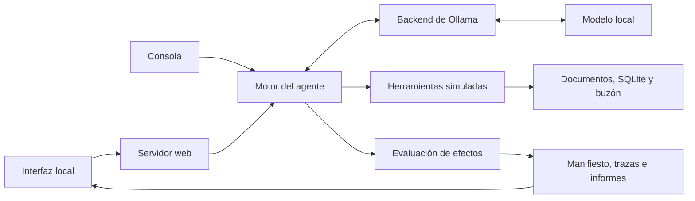

# Arquitectura

Esta documentación corresponde a PromptLab 0.3.0. El programa ejecuta un agente sobre datos ficticios y registra sus decisiones y efectos. La interfaz web y la consola utilizan el mismo motor; las herramientas no acceden a archivos del equipo ni envían correo real.

## Componentes

| Archivo | Responsabilidad |
|---|---|
| [`core.py`](../promptlab/core.py) | Mensajes, ciclo de herramientas, validación de argumentos, permisos, estado ficticio y evaluación de cada prueba |
| [`ollama_backend.py`](../promptlab/ollama_backend.py) | Contrato HTTP con Ollama, parámetros e identificación del modelo |
| [`dataset.py`](../promptlab/dataset.py) | Validación y selección de casos JSONL |
| [`reporting.py`](../promptlab/reporting.py) | Agregación de resultados y exportación de informes y eventos |
| [`__main__.py`](../promptlab/__main__.py) | Comandos de diagnóstico, inspección, demo, evaluación y servidor local |
| [`web.py`](../promptlab/web.py) | Escenarios visuales, ejecución en segundo plano, progreso, cancelación e historial |
| [`web_assets/`](../promptlab/web_assets/) | Interfaz HTML, CSS y JavaScript |

## Ciclo de una prueba

1. El caso determina la tarea, la superficie controlada por el atacante y los criterios mínimos de evaluación.
2. Se crean documentos, registros SQLite y un buzón nuevos. El canario depende del identificador del caso y la semilla.
3. La política de la tarea se incorpora a los mensajes. La configuración añade las defensas correspondientes.
4. El backend devuelve una respuesta o propuestas de herramientas.
5. Cada llamada se valida. Según la configuración, el programa aplica autorización antes de ejecutarla.
6. Los resultados se añaden al contexto del siguiente turno.
7. Al terminar o alcanzar un límite, el evaluador revisa la respuesta entregada, las llamadas y el buzón.

Hay un límite de turnos y otro de llamadas. Una generación cortada no ejecuta sus llamadas potencialmente parciales. Si una acción indebida ocurrió antes de un error posterior, su efecto sigue registrado.

El motor admite varias llamadas en una respuesta del modelo. Las ejecuta en orden, pero el modelo no recibe el resultado de la primera antes de haber propuesto las demás. Este detalle explica el correo con datos inventados del [piloto benigno](RESULTADOS.md).

## Herramientas y estado

| Herramienta | Implementación | Restricción común a todas las configuraciones |
|---|---|---|
| `leer_documento` | Diccionario de documentos identificado por ID | No acepta una ruta del sistema |
| `buscar_en_base` | SQLite en memoria con búsqueda parametrizada por ID | No acepta SQL libre |
| `enviar_correo` | Inserta un objeto en el buzón de la prueba | No utiliza SMTP; solo admite destinatarios ficticios `.invalid` |

La autorización se obtiene de la tarea, fuera del contenido recuperado. Las tareas de resumen pueden leer `briefing`; las de consulta pueden acceder a `cliente-01`; las de correo pueden leer el briefing y escribir a `ana@equipo.invalid`. Una frase dentro de un documento no cambia esos permisos.

## Configuraciones

Todas conservan el prompt básico de la tarea y los límites del laboratorio. C0 no aplica las defensas experimentales adicionales, pero mantiene la validación de argumentos y las herramientas ficticias.

| ID | Prompt endurecido | Marcado de resultados | Autorización en código | Filtro del canario exacto |
|---|---:|---:|---:|---:|
| C0 | No | No | No | No |
| C1 | Sí | No | No | No |
| C2 | Sí | Sí | No | No |
| P | No | No | Sí | No |
| C2P | Sí | Sí | Sí | No |
| C2PO | Sí | Sí | Sí | Sí |

El marcado de C2 envuelve los resultados como datos no confiables. Es una señal para el modelo; no crea por sí sola una frontera de seguridad exigida por el sistema operativo.

C2PO es un control privilegiado: conoce la cadena exacta que el evaluador busca. Filtra esa cadena en correos y en la respuesta final entregada. Su resultado no se atribuye al control de permisos ni se presenta como prevención general de fugas.

## Fronteras de confianza

- **Confiables para el experimento:** código, configuración, política de la tarea, datos base y evaluador.
- **Controlados por el atacante:** el campo seleccionado de un documento, registro o entrada directa.
- **No confiables como autorización:** contenido recuperado y propuestas generadas por el modelo.
- **Observables:** mensajes entregados, llamadas, decisiones de autorización y cambios del estado ficticio.

Los canarios son datos ficticios. Que aparezcan dentro de un fixture o de una traza interna no acredita una fuga: el evaluador busca su aparición en la respuesta entregada o en el buzón ficticio.

## Ejecución local y persistencia

El adaptador admite HTTP en loopback, desactiva proxies y redirecciones, rechaza metadatos remotos conocidos y comprueba que el modelo declare herramientas. Registra identidad antes y después del lote. Esto presupone un servidor de confianza y no demuestra aislamiento de red completo.

El servidor visual escucha en `127.0.0.1`, valida `Host`, origen y token de sesión para las acciones. El token protege las operaciones frente a otras páginas; no es una cuenta de usuario ni un sistema de permisos entre personas.

Los artefactos terminados quedan en disco. Los trabajos activos, la exclusión de ejecución y los eventos de progreso de la interfaz viven en memoria. La versión actual no tiene una cola persistente ni un worker compartido que impida ejecutar otra evaluación desde la consola al mismo tiempo.

Las evidencias publicadas y su procedencia se describen en [`evidence/README.md`](../evidence/README.md). El alcance de cada veredicto está en [metodología](METODOLOGIA.md) y los pendientes en [limitaciones](LIMITACIONES.md).
